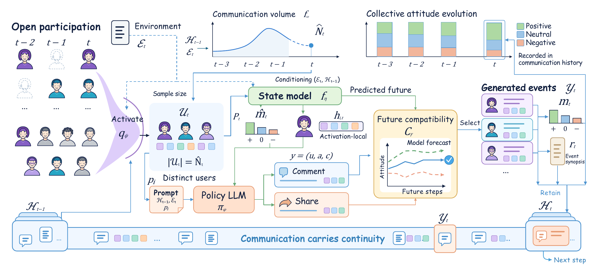

<h1 align="center">OpenSim: Rethinking Social Simulation in Open-Population Systems: From Persistent Agents to Communication Processes</h1>

<p align="center">
  <a href="https://github.com/AI4SS/OpenSim"></a>
  <a href="pyproject.toml"></a>
  <a href="LICENSE"></a>
</p>

OpenSim is a communication-centered framework for social simulation in
open-population systems, where participation is sparse and changes over time.
Persistent account identities do not provide continuously observable individual
states. OpenSim therefore shifts the simulation target from presumed psychological
trajectories to the observable evolution of social communication: who participates,
what they communicate, and how these communications shape subsequent dynamics.
Given a system-visible history and declared environmental inputs, it recursively
generates and updates the platform process, without requiring an LLM to stand in
for a human mind.



*Overview from the paper. The diagram presents the paper-level formulation;
the runnable defaults of this release are described below.*

## Highlights

- **From persistent agents to communication processes.** Make observable
  communication history—not unobserved individual psychological trajectories—the
  recursive object of simulation, in conceptual alignment with social systems theory.
- **Endogenous participation in an open population.** Realize participants from a
  global user pool and generate their actions and content without access to the
  realized future participant sequence.
- **An explicit system–environment boundary.** Simulate endogenous communication
  dynamics conditional on declared environmental inputs, rather than asking the
  model to invent external events or reconstruct the single future that occurred.
- **Future-constrained communication learning.** Connect locally plausible
  communicative acts with subsequent collective dynamics. Future trajectories
  provide training supervision only; inference generates and selects communications
  using information available at simulation time.

## Project Structure

```text
OpenSim-Release/
├── assets/                     # Paper overview image
├── configs/
│   ├── train.yaml              # Training and policy-validation settings
│   ├── simulate.yaml           # Simulation settings
│   └── evaluate.yaml           # Annotation and metric settings
├── data/
│   ├── DATASET_DISCLOSURE.md    # Dataset and evaluation disclosure
│   ├── index.csv               # Event metadata and relative data paths
│   ├── train/{macro,micro}/     # Training event files
│   ├── test/{macro,micro}/      # Test event files
│   └── figures/{train,test}/   # Event-level dataset visualizations
├── opensim/
│   ├── state_transition/       # Latent-state model and event datasets
│   ├── policy/                 # Policy, trajectory critic, and generation
│   ├── training/               # Data preparation, training, and validation
│   ├── simulation/             # Population sampling and closed-loop rollout
│   ├── evaluation/             # Deterministic, NLL, semantic, and metric stages
│   ├── volume.py               # Causal interaction-volume forecaster
│   ├── summarizer.py           # Communication-history summarization
│   └── pipeline.py             # Workflow orchestration
├── scripts/                    # Workflow entry points
└── tests/                      # Focused regression tests
```

## Usage

### 1. Environment and Data

Use **Python 3.11 or newer** and a CUDA-enabled environment for training and
simulation. The default base model is **Qwen/Qwen3-1.7B**; an existing local model
directory can be supplied with `--base-model`.

Run the following commands from the repository root:

```bash
python -m venv .venv
source .venv/bin/activate
python -m pip install -e .
```

The largest micro-level JSON file is stored with [Git LFS](https://git-lfs.com/). Install
Git LFS before cloning, then fetch the dataset objects:

```bash
git lfs install
git clone https://github.com/AI4SS/OpenSim.git
cd OpenSim
git lfs pull
```

If the repository is already cloned, run `git lfs install` and `git lfs pull`
inside it. A GitHub source ZIP may contain LFS pointers instead of the actual
micro-level data; use a Git LFS-enabled clone for training and simulation.

The dataset is organized under `data/`, with paired macro JSONL and micro JSON
files and an event index. See the [dataset disclosure](data/DATASET_DISCLOSURE.md)
for dataset documentation. Use `--data-dir /path/to/data` when the dataset is
stored elsewhere; code-only copies of this repository do not include it.

Model weights, intermediate training data, simulation outputs, and evaluation
results are not bundled. Generated artifacts are written to `--output-dir`;
external datasets and checkpoints are not implicitly copied.

### 2. Inspect the Workflow

Print all stage commands without loading models, making API requests, or creating
run outputs:

```bash
python scripts/run.py --dry-run
```

Settings are separated into [training](configs/train.yaml),
[simulation](configs/simulate.yaml), and [evaluation](configs/evaluate.yaml).
Use `--config-dir /path/to/configs` to select another configuration directory.

### 3. Train

Train the state and volume models, prepare policy and summarizer examples, train
the summarizer and supervised policy, then train and validate the future-constrained
policy:

```bash
python scripts/train.py --base-model Qwen/Qwen3-1.7B --output-dir outputs
```

The future-policy validation stage checks response sensitivity before checkpoint
promotion. Simulation requires a passed validation gate.

### 4. Simulate

Use the checkpoints produced by training:

```bash
python scripts/simulate.py --base-model Qwen/Qwen3-1.7B --output-dir outputs --resume
```

The default configuration uses `scale_factor: 1`, batch size 16, four policy
candidates, and 50 warmup interactions per event. Historical state volume defaults
to `state_history_volume: simulated`: after each completed day, the generated row
count multiplied by the scale factor is written back for later days. Set the
option to `observed` in a separate configuration/output directory for that ablation;
the history mode cannot change during resume.

The volume model predicts sampled interactions, not platform-wide traffic.
The scale factor reverses computational subsampling, not population sampling.
Existing state checkpoints trained with observed-count features undergo an
input-distribution change when simulated history is used; selecting this option
does not retrain those checkpoints.

### 5. Evaluate

Semantic evaluation calls an external model and may incur API charges. Set
`OPENAI_API_KEY` in your environment; `OPENAI_BASE_URL` optionally selects a
compatible endpoint. Do not store credentials in the repository.

```bash
python scripts/evaluate.py --base-model Qwen/Qwen3-1.7B --output-dir outputs --resume
```

Evaluation runs deterministic table construction, teacher-forced response-token
NLL, semantic annotation, and metric aggregation. Native-state CAD is reported
under `evaluation/metrics/`; text-classification CAD is reported separately under
`evaluation/metrics/text_classification/`.

Semantic annotation checks exact item identities and all eight label vocabularies.
The default budget is five total attempts per text, including the initial request
and attempts retained across resume. Accepted records are cached; only incomplete
items are retried, and exhausted items remain explicitly incomplete.

### 6. Full Runs, Individual Stages, and Resume

Run the complete workflow, including API-based evaluation:

```bash
python scripts/run.py --base-model Qwen/Qwen3-1.7B --output-dir outputs
```

Use `--stage NAME` to run a single stage, or add `--dry-run` to inspect its command:

```bash
python scripts/evaluate.py --stage metrics --output-dir outputs --resume --dry-run
```

Stages sharing an output directory must use the same model, device, configuration,
and dataset arguments. `--resume` skips completed stages with the required artifacts
and resumes supported simulation/evaluation stages. Interrupted training requires
a new output directory. Never reuse a historical run's manifest for a relocated
or reconfigured experiment.

### Using Existing Checkpoints

For inference and evaluation, `--checkpoint-root` selects an existing checkpoint
tree with the following layout:

```text
checkpoints/
├── state_transition/
├── volume/
├── policy_future/best_checkpoint/
└── summarizer/best_checkpoint/
```

Supply the corresponding passed gate with `--validation-gate` for simulation and
the matching base model with `--base-model`. Keep these options unchanged in
subsequent evaluation/resume commands. `--checkpoint-root` is not a training
destination override.

`--simulation-micro-dir` can select a scaled reference pool while state features
continue to use `data/test/macro`. `--evaluation-macro-dir` selects the corresponding
evaluation targets. For scale10, explicitly use `scale_factor: 10` and matching
scaled inputs; the default configuration remains full scale1.

## License

This project is licensed under the [MIT License](LICENSE).
